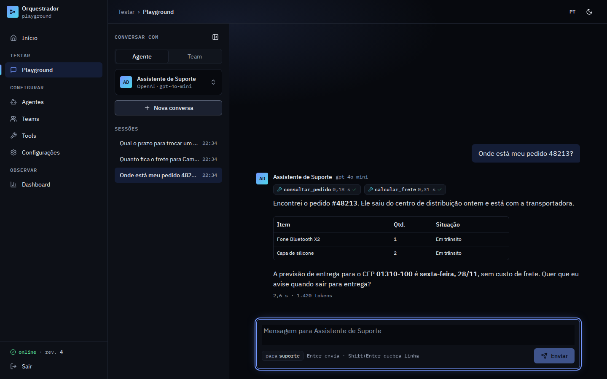
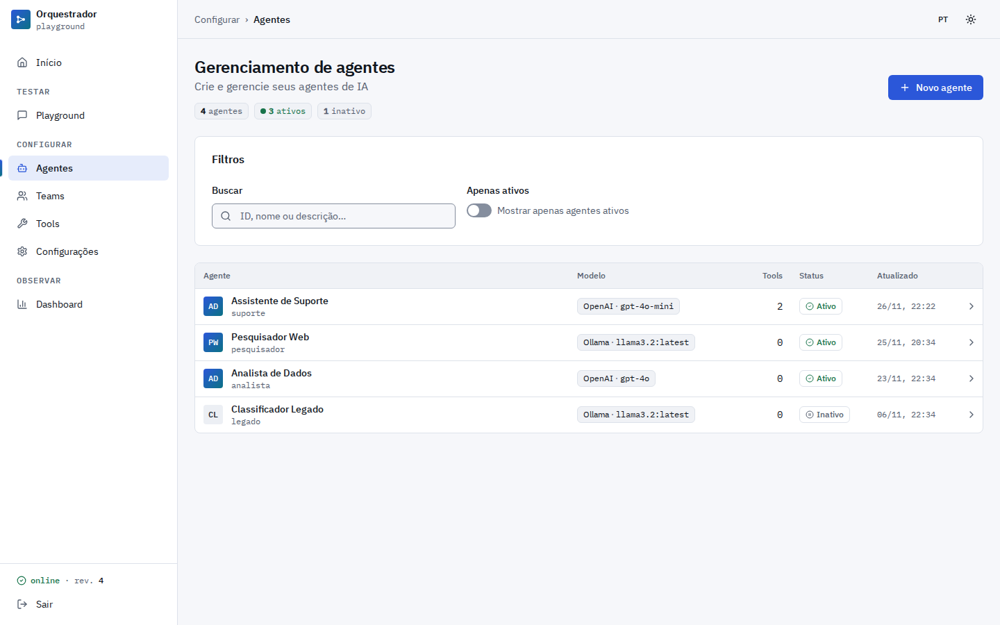
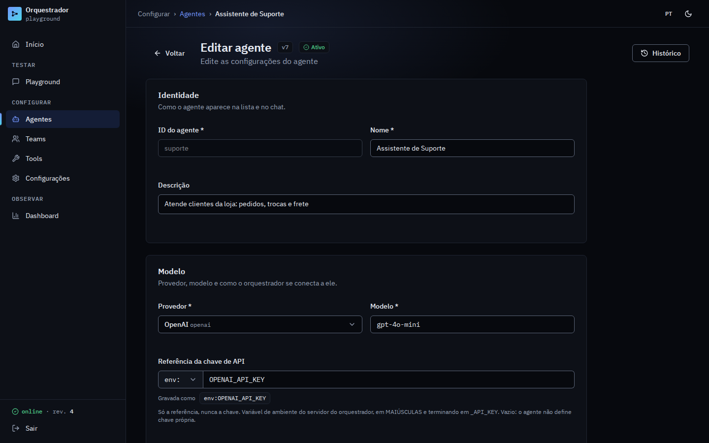
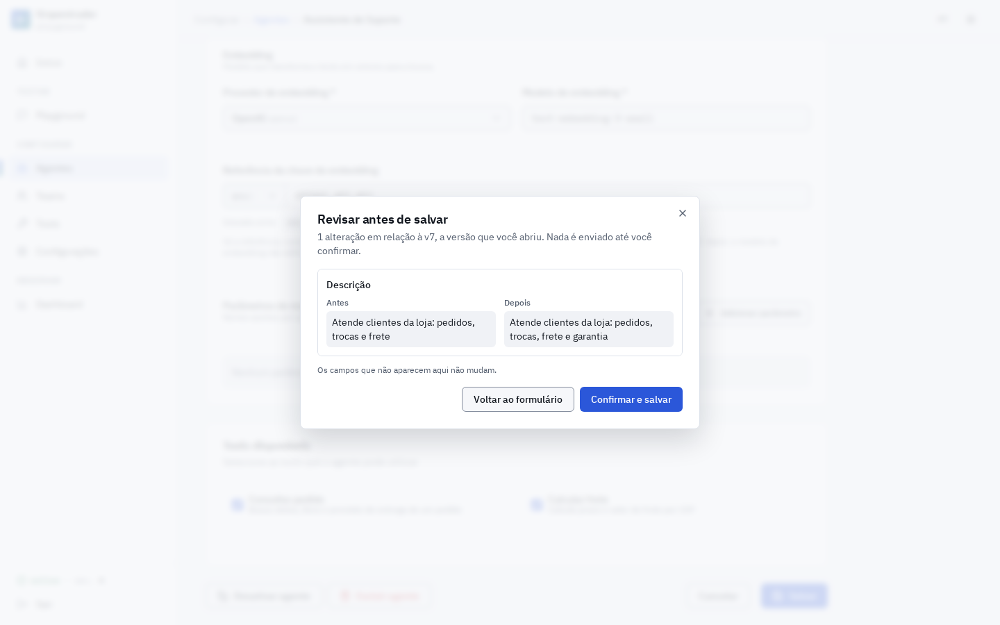
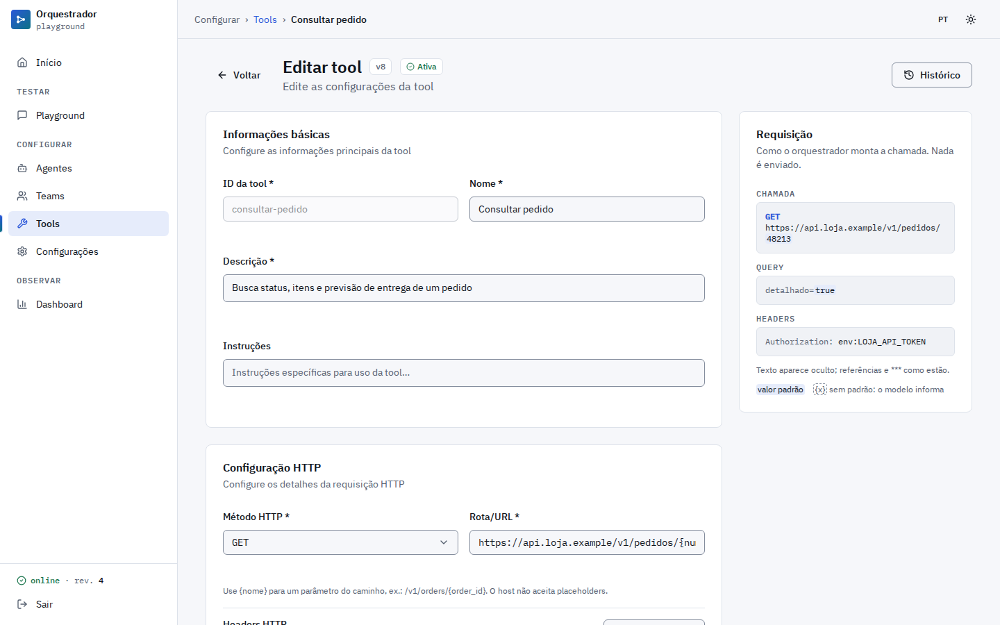
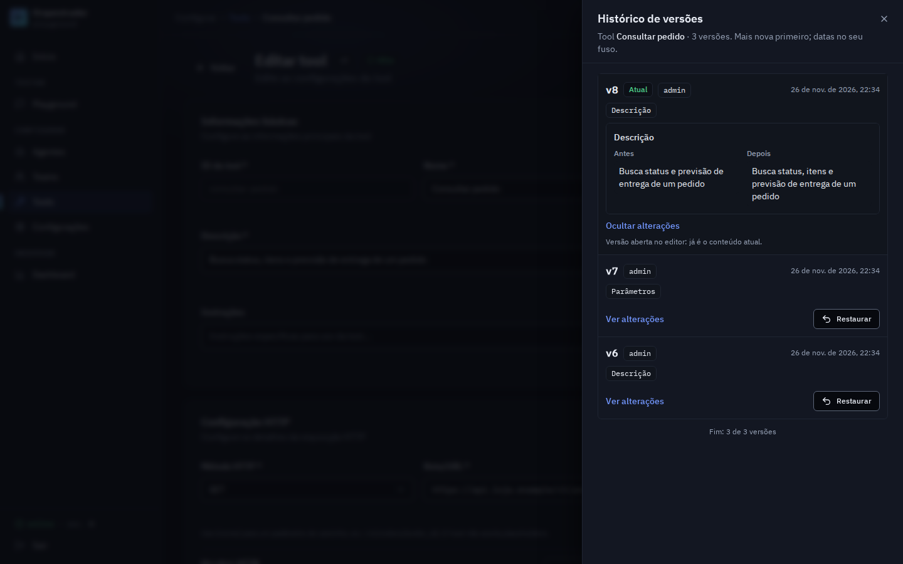
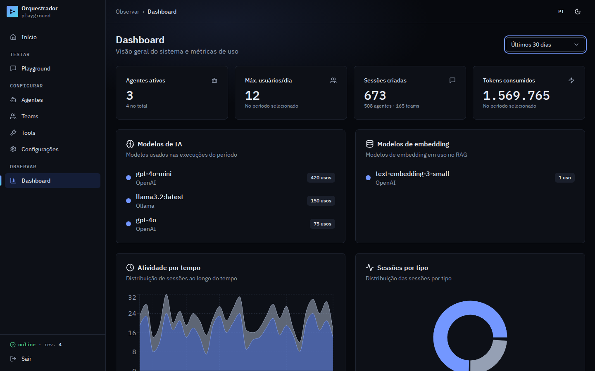
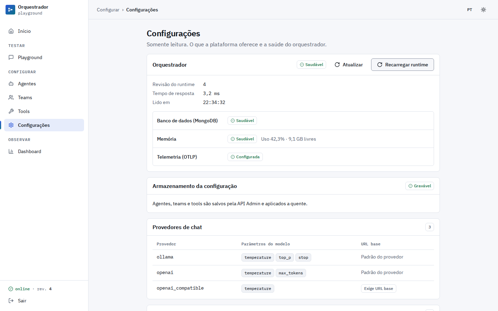
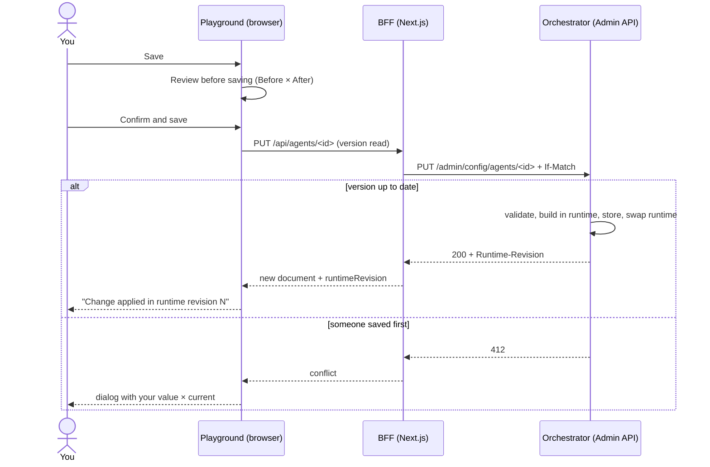
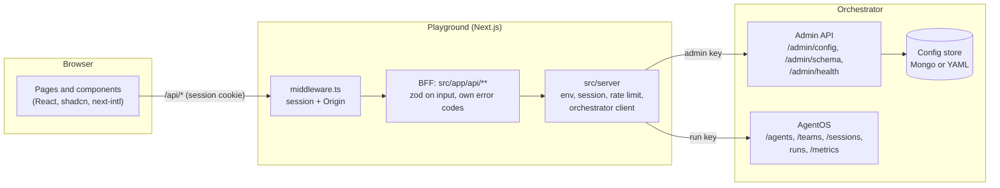

# 🖥️ Orchestrator Playground

> Full guide in English. **[Guia em português](README.pt-br.md)** · **[Home](README.md)**

Management web UI for the [AI Agents Orchestrator](https://github.com/Mosfet04/orquestradorIAPythonArgo): create and edit agents, teams and HTTP tools, try them in a streaming chat and follow usage on a dashboard. What you save goes into the orchestrator's config and is live in chat right away, with no restart.



> The UI defaults to Brazilian Portuguese (screenshots are in pt-BR); switch to English with the `PT`/`EN` button in the header.

---

## 📋 Table of contents

- [Overview](#-overview)
- [Screens](#️-screens)
- [Quick start](#-quick-start)
- [Configuration](#️-configuration)
- [Usage](#-usage)
- [Features in depth](#-features-in-depth)
- [Architecture](#️-architecture)
- [Interface and accessibility](#-interface-and-accessibility)
- [Security](#-security)
- [Development](#️-development)
- [Troubleshooting](#-troubleshooting)
- [License and credits](#-license-and-credits)

---

## 🎯 Overview

The playground is the orchestrator's management UI. It has no database of its own and never touches Mongo: it reads and writes everything through the orchestrator's **Admin API** (`/admin/config/*`), which validates, persists and hot-applies the config. The browser only talks to the playground itself. A **BFF** (the Next.js `src/app/api/**` routes) keeps the orchestrator URL and keys on the server.

### Key features

- 💬 **Chat playground**: talk to agents and teams with streaming, tool calls with timing and status, a reasoning panel, time and tokens per response, per-user session history, and model errors explained in plain language with **Resend**.
- 🤖 **Full editors**: agents, teams and HTTP tools cover the orchestrator's whole document. Forms are built from `GET /admin/schema`: providers, models, parameters, team modes, HTTP methods and parameter types all come from there.
- 🛡️ **No-surprise saves**: a "Before × After" diff before writing, a conflict dialog when someone else saved in the meantime, apply status with the runtime revision, and a draft warning when leaving with unsaved edits.
- 🕓 **History and restore**: every Admin API write becomes a version, with what changed and a restore button.
- 🔑 **Secrets by reference only**: API keys and credential headers accept only `env:<VARIABLE>` or `file:/path`. The value never passes through the playground.
- 📊 **Dashboard**: active agents, daily peak users, sessions, tokens, models and daily activity, with a period filter.
- 🩺 **Settings**: orchestrator health, runtime revision, config store, available providers and "Reload runtime". The navigation footer shows whether the orchestrator is online, degraded or offline.
- 🔐 **Sign-in**: one user configured on the server, a signed 12 h session and per-IP attempt limiting.
- 🎨 **Own design system**: light and dark themes via tokens, IBM Plex, responsive layout (navigation becomes a side menu on mobile), pt-BR and EN.
- 🧪 **Tested end to end**: Vitest + Testing Library + MSW, Playwright against a fake orchestrator, and the OpenAPI contract checked in CI.

---

## 🖼️ Screens

| | |
|---|---|
| **Agent list**: search, active filter, counters, provider and model, last write time. | **Agent editor**: identity, model, key by reference, parameters, instructions, execution, RAG and tools. |
|  |  |
| **Review before saving**: only the fields that changed, never exposing secrets. Nothing is sent until you confirm. | **Tool editor**: the route with `{param}` bound to parameters, and the "Request" card showing the call the orchestrator will build. |
|  |  |
| **Version history**: who wrote it (key role), when and what changed, with Restore. | **Dashboard**: indicators, models in use and activity over the chosen period. |
|  |  |
| **Settings**: health, runtime revision, config store and providers. | |
|  | |

> Screenshots use demo data served by the test suite's fake orchestrator (`e2e/fake-orchestrator/`).

---

## 🚀 Quick start

### Requirements

- **Node.js** 22.18+ or 24+
- **pnpm** 10.33.0 (pnpm only; the version comes from `packageManager` in `package.json`)
- The **orchestrator** running, with `API_KEY_RUN` and `API_KEY_ADMIN` set ([orchestrator README](https://github.com/Mosfet04/orquestradorIAPythonArgo))

### Install

```bash
git clone https://github.com/Mosfet04/playgroundOrquestrador.git
cd playgroundOrquestrador
pnpm install
```

Generate the sign-in password hash. The password goes through stdin and stays out of your shell history:

```bash
read -rs PW && printf '%s' "$PW" | pnpm -s auth:hash; unset PW
# output: scrypt:<salt>:<hash>  → value of AUTH_PASSWORD_HASH
```

Create `.env.local`:

```env
ORCHESTRATOR_URL=http://localhost:7777
ORCHESTRATOR_API_KEY_RUN=<orchestrator API_KEY_RUN>
ORCHESTRATOR_API_KEY_ADMIN=<orchestrator API_KEY_ADMIN>
SESSION_SECRET=<random secret, 32+ characters, e.g. openssl rand -base64 48>
AUTH_USERNAME=admin
AUTH_PASSWORD_HASH=<output of pnpm auth:hash>
```

Start the playground:

```bash
pnpm dev          # http://localhost:3000
```

Sign in with the user and password from `.env.local`. The **Home** screen has a three-step guide (create an agent, create a tool, try it in the playground).

**Sample data (optional):** use the orchestrator's seed (`mongo-init/` for Mongo, `config.example.yaml` for the YAML store) or create everything from the screens.

**Production:** `pnpm build` and `pnpm start`. Variables are only needed at `start`. Serve over HTTPS: outside `pnpm dev` the session cookie is `Secure`. There is no Dockerfile.

---

## ⚙️ Configuration

### Environment variables

| Variable | What it is |
|---|---|
| `ORCHESTRATOR_URL` | Orchestrator URL, `http(s)://` (e.g. `http://localhost:7777`). To switch orchestrators, change it and restart. |
| `ORCHESTRATOR_API_KEY_RUN` | The orchestrator's `API_KEY_RUN`: chat and sessions. |
| `ORCHESTRATOR_API_KEY_ADMIN` | The orchestrator's `API_KEY_ADMIN`: config, schema, metrics, health and session deletion. |
| `SESSION_SECRET` | Secret that signs the session cookie, 32+ characters. |
| `AUTH_USERNAME` | Sign-in user. |
| `AUTH_PASSWORD_HASH` | scrypt hash of the password, from `pnpm auth:hash`. Never the plain password. |

Variables are validated with zod in `src/server/env.ts` and exist only on the server. If one is missing, the server refuses requests and the log names the variable, never its value. In `pnpm dev` this happens at startup; in `pnpm start`, on the first request, when Next runs `src/instrumentation.ts`.

### Sign-in and session

- A single user, set by `AUTH_USERNAME` and `AUTH_PASSWORD_HASH`. Every page and all of `/api/*` require a session.
- The session is a signed cookie (jose) that lasts **12 h**, with no renewal. There is no server-side revocation: rotating `SESSION_SECRET` signs everyone out.
- Sign-in allows **5 attempts per IP every 15 min**. The 6th gets 429, and a correct password resets the count. The counter lives in process memory, so it holds for a single replica and resets on restart.
- The IP is the last `X-Forwarded-For` entry. **Serve the playground behind a proxy that sets this header** (nginx, Caddy, your cloud load balancer). Without it, the client picks the value and the per-IP limit doesn't hold.
- Mutations (POST, PUT, DELETE) require the playground's own `Origin` (`src/middleware.ts`).
- The chat sessions' `user_id` is the signed-in user: each user sees only their own conversations.

---

## 🧭 Usage

1. **Register a tool** in **Tools → New tool**. Example: ID `consultar-pedido`, method `GET`, route `https://api.loja.example/v1/pedidos/{numero}`, an `Authorization` header with the secret `env:LOJA_API_TOKEN`, and the parameter `numero` (string, required). The **Request** card shows the call before you save.
2. **Create an agent** in **Agents → New agent**: provider and model, key reference (`env:OPENAI_API_KEY`), instructions, the tools it may use and, optionally, RAG.
3. **Try it in the Playground**: pick the agent and chat. After saving an agent or team, **Test now** opens the playground with it selected and an empty conversation.
4. **Build a team** in **Teams → New team**: check the member agents, pick the coordination mode (each comes with its description) and the leader model.
5. **Follow** usage on the **Dashboard** and orchestrator health in **Settings**.

Every change takes effect in chat **right after saving**: the Admin API builds the config, stores it and swaps the runtime.

---

## ⚡ Features in depth

### 💬 Chat playground

- **Agent** and **Team** tabs, with the entity picker (provider and model visible) and the signed-in user's session list, reloaded from the server after each response.
- Unbuffered streaming: the BFF passes the orchestrator's run stream straight to the browser.
- **Tool calls** as chips with name, time and status (running, done, error). For teams, delegation to the member is shown.
- **Reasoning panel** with agno 3 steps (title, confidence and collapsible detail) for agents with reasoning on.
- Time and tokens per response; media (image, audio, video).
- Agent and user markdown rendered without raw HTML: links only `http(s)`/`mailto` with safe `rel`, images become links and are not loaded.
- **Model errors** become one sentence per type (provider overloaded or rate-limited, rejected parameter, other). The provider text, sanitized by the BFF, sits under **Technical details**. **Resend** repeats the same message in the same session. Reopening the session marks the unanswered question, with Resend.
- The URL keeps the entity and session (`?agent=`, `?team=`, `?session=`): bookmark it, open it in a new tab, use Back/Forward.
- Another user's conversation is refused with a message suggesting to start a new one.

### 📋 Agent, team and tool lists

- Search by ID, name or description; **Active only** filter; counters (total, active, inactive).
- Provider and model columns (readable label, e.g. `OpenAI · gpt-4o-mini`), tool count, status and **Updated**: the last write time (`updated_at` from the Admin API, in the browser's time zone). Documents without it, such as YAML-store or seed documents, show "—".
- Listing, search and filters run in the BFF over the whole list.

### 🤖 Agent editor

- **Identity**: ID (only `a-z`, `0-9`, `-` and `_`, fixed after creation), name and description.
- **Model**: provider, model, base URL (shown and required when the provider needs it), API key reference and model parameters (`temperature`, `max_tokens`…, per provider). The value type is inferred, and `0,7` becomes `0.7`.
- **Instructions** (prompt) and **Execution**: Markdown, date and time in context, history (with the number of runs within the schema range), reasoning, expose reasoning, user memory and session summary, each with the orchestrator's default.
- **RAG**: document, search strategy (semantic or hierarchical), embedder (provider, model, parameters, base URL, key reference). Turning it off keeps the values with `active: false`.
- **Available tools**: registered tools as checkable cards; with none, a "Create tool" shortcut.
- Saving sends the form's document. Anything the screen doesn't know (a new orchestrator key, for instance) is preserved.

### 👥 Team editor

- **Members**: agents as checkable rows, with search. At least one is required, and the stored order is kept. A stored ID that no longer exists is shown checked with a warning.
- **Coordination mode**: one card per mode the schema offers (e.g. `route`, `coordinate`, `broadcast`), with its description. A stored value outside the list is kept until you change it.
- **Leader model**, instructions and execution (with user memory).
- Deleting an agent that is a team member is refused by the orchestrator; the dialog lists the teams, linking to each.

### 🔧 Tool editor

- Method, route and headers. The route accepts `{param}` in the path and query (not in the host). A placeholder with no parameter of the same name blocks the submit, and the editor offers to create the parameter.
- Parameters with name, type (`string`, `integer`, `float`, `boolean`, `object`, `array`), description, required and default value. The default value is only an example: the orchestrator doesn't send it in the call.
- **Request** card: shows, without calling the route, how the orchestrator builds the call (placeholders from default values, other parameters in the query for GET/DELETE or in the JSON body for POST/PUT/PATCH).
- **Headers** in Text or Secret mode. Text values come back masked (`***`) and never reach the browser; saving unchanged keeps the stored value. Credential headers (`Authorization`, `Cookie`, `*-Key`, `*-Token`) take only a reference; typing one of those names on an empty row switches it to Secret automatically.
- A secret reference in a header only works for hosts in the orchestrator's `TOOL_ROUTE_ALLOWLIST`. Otherwise, the 422 shows on the headers group with the reason.

### 🔑 Secrets

The same picker serves the agent's model key, the team leader's, the RAG embedder's and tool headers: a format (`env:` or `file:`) plus the target, following the orchestrator's rule (`env:<PROVIDER>_API_KEY` or a path under `SECRETS_DIR`). A value without that prefix is refused in the browser and never leaves it. A stored value outside the rule is shown with a warning so it can be fixed.

### 🛡️ Saving safely



- **Review before saving**: when editing, Save opens the list of changed fields (Before × After) against the version you opened. Nothing is sent until "Confirm and save", and what was listed is exactly what goes in the PUT. Secret references show as they are; `***` and text headers never show the value. With no changes, Save is dimmed with a "nothing to save" hint. Creating skips this dialog.
- **Conflict (412)**: if the config changed after you opened the editor, the dialog reloads the current version and compares field by field. Options: back to the form, reload the current one (discards your edits) or save yours on top.
- **Apply status**: after saving, the editor shows "applied in runtime revision N", "not applied" (the config doesn't build: nothing stored, the previous version stays live) or "not confirmed" (the orchestrator failed after receiving it; "Reload" shows what was stored).
- **Test now**: on the "applied" status of agents and teams, goes to the playground with the entity and an empty conversation.
- **Rejected field (422)**: the field the orchestrator rejects is flagged on the form, without echoing the value.
- **Drafts**: with unsaved edits, leaving through a link, Back/Cancel, "Sign out", browser Back/Forward or closing the tab asks for confirmation.
- **Deactivate, reactivate and delete**: the header shows the Active/Inactive badge; the footer has Deactivate or Reactivate (they don't save form edits) and Delete, which removes for good.

### 🕓 History and restore

The **History** button (agents, teams and tools) opens a panel with the writes made through the Admin API, newest first, 20 at a time: version, role of the key that wrote it (`admin`, `local-dev`; never a person), date in your time zone and the changed fields, with Before × After. **Restore** shows what changes from the current version to the chosen one, warns that unsaved edits are discarded and writes a new version ("v6 restored as v9"). With the YAML store, history is always empty.

### 📊 Dashboard

Active agents (and the total), daily peak users, agent and team sessions, tokens used, AI and embedding models in use, daily activity and sessions by type. Period filter: Today, 7, 30 and 90 days (UTC days). Numbers come from the orchestrator's `GET /metrics`. The BFF requests a recompute (`POST /metrics/refresh`) at most once a minute; if it fails, the read goes on with what's there. Token usage per agent waits for per-agent metrics in the orchestrator.

### 🩺 Settings and connection status

- Orchestrator health (`/admin/health`): overall state, runtime revision, response time and checks (database, memory, telemetry).
- Config store writable or read-only. With a read-only store, forms say so and disable fields, Save and Delete.
- Chat and embedder providers, with each one's parameters and whether it needs a base URL.
- **Reload runtime** (with confirmation): rereads the store and returns the new revision. Use it after editing the orchestrator's YAML by hand.
- The navigation footer shows "online · rev. N", "degraded · rev. N" or "offline", linking to the page. When offline or degraded, it retries with growing backoff (5, 15, 30, 60 s) and when the tab regains focus.

---

## 🏗️ Architecture



**Rules the architecture enforces:**

- **The browser never sees an orchestrator key or URL.** Only `src/server` knows them, and that code can't be imported by client components (`import 'server-only'` plus the `no-restricted-imports` lint rule).
- **The config belongs to the orchestrator.** The playground has no database access: it writes through the Admin API, which validates, persists and hot-applies.
- **zod at every boundary**: request bodies, orchestrator responses and env.
- **Own error codes**: the client never gets `String(err)`, a stack trace or raw orchestrator text.
- **Optimistic concurrency**: the `version` read goes back in `If-Match` on save, delete, deactivate and restore.

### Folder structure

```
src/
├── app/
│   ├── (app)/               # routes inside the shell (navigation + header):
│   │                        # /, /playground, /agents, /teams, /tools (list, /new, /<id>),
│   │                        # /dashboard, /settings; error.tsx, not-found.tsx, in-shell 404
│   ├── api/                 # BFF: agents, teams, tools (+ history/restore), config (schema,
│   │                        # reload), dashboard, orchestrator (health, runtime), playground, auth
│   └── login/               # sign-in screen (outside the shell)
├── components/
│   ├── layout/              # shell, navigation, header, theme, language, connection status
│   ├── management/          # agents, teams, tools, dashboard, settings, Home
│   │   └── common/          # editor pieces: diff, conflict, history, secret, draft guard
│   ├── playground/          # chat and session panel
│   └── ui/                  # shadcn primitives (no business rules)
├── hooks/                   # chat stream, sessions, selected entity
├── i18n/                    # next-intl: language from cookie
├── lib/                     # pure code: diff, secrets, tool route and preview, providers...
├── server/                  # 'server-only': env, session, password, rate limit
│   └── orchestrator/        # orchestrator client, one module per domain + openapi.d.ts
├── middleware.ts            # session required on pages and /api/*, Origin on mutations
└── store.ts                 # zustand: chat session state only
messages/                    # UI strings (pt-BR.json, en.json)
docs/                        # roadmap, decisions, design, OpenAPI contract, QA
e2e/                         # Playwright + fake orchestrator
tests/                       # Vitest + Testing Library + MSW
```

### Config format

The format is the orchestrator's Admin API: a snake_case document with `version`. Legacy fields (`nome`, `descricao`) stay in the contract.

<details>
<summary><strong>Agent</strong> (<code>/admin/config/agents/&lt;id&gt;</code>)</summary>

```json
{
  "id": "suporte",
  "nome": "Assistente de Suporte",
  "descricao": "Atende clientes da loja: pedidos, trocas e frete",
  "factory_ia_model": "openai",
  "model": "gpt-4o-mini",
  "api_key_ref": "env:OPENAI_API_KEY",
  "model_params": { "temperature": 0.3 },
  "prompt": "Você é o assistente de suporte da loja...",
  "tools_ids": ["consultar-pedido"],
  "rag_config": {
    "active": true,
    "doc_name": "politica-de-trocas",
    "factory_ia_model": "openai",
    "model": "text-embedding-3-small",
    "search_strategy": "semantic",
    "api_key_ref": "env:OPENAI_API_KEY"
  },
  "markdown": true,
  "add_history_to_context": true,
  "num_history_runs": 5,
  "user_memory_active": true,
  "active": true,
  "version": 7
}
```
</details>

<details>
<summary><strong>Team</strong> (<code>/admin/config/teams/&lt;id&gt;</code>)</summary>

```json
{
  "id": "atendimento",
  "nome": "Time de Atendimento",
  "descricao": "Roteia o cliente para o agente certo",
  "prompt": "Encaminhe pedidos ao suporte e dúvidas de produto ao pesquisador.",
  "member_ids": ["suporte", "pesquisador"],
  "mode": "route",
  "factory_ia_model": "openai",
  "model": "gpt-4o-mini",
  "user_memory_active": true,
  "summary_active": false,
  "active": true,
  "version": 2
}
```
</details>

<details>
<summary><strong>Tool</strong> (<code>/admin/config/tools/&lt;id&gt;</code>)</summary>

```json
{
  "id": "consultar-pedido",
  "name": "Consultar pedido",
  "description": "Busca status, itens e previsão de entrega de um pedido",
  "route": "https://api.loja.example/v1/pedidos/{numero}",
  "http_method": "GET",
  "headers": { "Authorization": "env:LOJA_API_TOKEN", "X-Conta": "***" },
  "parameters": [
    { "name": "numero", "type": "string", "description": "Número do pedido", "required": true }
  ],
  "active": true,
  "version": 5
}
```
</details>

The tool's `description` and each parameter's are required. The `updated_at` the API returns is metadata, like `version`: the PUT doesn't send it back.

---

## 🎨 Interface and accessibility

- **Design system**: colors only through tokens (shadcn CSS vars in `src/app/globals.css`, `:root` for light and `.dark` for dark), mapped in `tailwind.config.ts`. No hex or raw palette in components. Visual direction and tokens in [`docs/design/design-system.md`](docs/design/design-system.md).
- **Typography**: IBM Plex Sans and Mono, served by the app itself (`next/font/local`).
- **Theme**: Light, Dark or System (default), from the header button; stored in `localStorage`.
- **Language**: pt-BR (default) and EN with `next-intl`, from the `PT`/`EN` button. Stored in the `locale` cookie, not in the URL, and switches without reloading or losing the conversation. Strings live in `messages/*.json`; lint rejects literal text in JSX and a test checks both catalogs have the same keys. Agent-generated content is not translated.
- **Responsive**: fixed navigation from 1024 px; below that, a side menu (Sheet). Larger controls and 44 px touch targets on mobile.
- **States**: loading (skeleton at final height), empty and error with "Try again" on every screen; an unknown address shows the in-app 404.
- **Accessibility**: visible focus on every interactive element, field errors with `aria-invalid`/`aria-describedby` and `aria-live` announcements, contrast checked in both themes, and animations disabled under `prefers-reduced-motion`.

---

## 🔒 Security

| Risk | How the playground handles it |
|---|---|
| Key or internal URL leak | Only the server (`src/server`) knows them; CI checks that no test secret shows up in the bundle (`.next/static`). |
| Access without sign-in | `middleware.ts` requires a session on every page and on `/api/*`. |
| CSRF | Mutations only with the playground's own `Origin`; `HttpOnly`, `SameSite=Lax` cookie, `Secure` outside dev. |
| Sign-in brute force | 5 attempts per IP every 15 min (needs a proxy that sets `X-Forwarded-For`). |
| XSS through agent content | Markdown without raw HTML (`rehype-sanitize` with a strict schema, no `rehype-raw`), filtered links, images as links. |
| Secret stored in config | References only (`env:`/`file:`); text headers come back as `***` and never reach the browser. |
| Leak through error messages | Responses with own error codes; provider text sanitized and size-capped. |
| Another user's session | `user_id` comes from the sign-in; someone else's conversation is refused. |

---

## 🛠️ Development

**Stack:** Next.js 15 (App Router), React 18, TypeScript, Tailwind + shadcn/ui (Radix), zustand (chat session), nuqs (URL state), next-intl, react-hook-form, zod, recharts, jose.

### Commands

```bash
pnpm dev              # http://localhost:3000
pnpm lint             # ESLint (includes the literal-text rule and the server/client boundary)
pnpm typecheck        # TypeScript
pnpm test             # Vitest + Testing Library + MSW (tests/)
pnpm test:watch
pnpm test:e2e         # Playwright (Chromium) against the fake orchestrator
                      # first time: pnpm exec playwright install chromium
pnpm build
pnpm format           # Prettier (check)
pnpm contract:check   # orchestrator types up to date with the contract snapshot
pnpm contract:update  # downloads the snapshot from a local orchestrator and regenerates types
```

### Tests

- **Unit, component and BFF** (`tests/`): Vitest + Testing Library + MSW. Any request outside the mocks fails the test.
- **Flows** (`e2e/`): Playwright against the **fake orchestrator** (`e2e/fake-orchestrator/server.ts`), which mimics AgentOS (agno 3.1.12) and the Admin API, requires the same keys and never calls an LLM or the network.
- Without `CI`, `pnpm test:e2e` starts the app with `next dev`. With `CI=true`, it runs `next build` + `next start`, as in CI. The build overwrites `.next`: stop any `next dev` first.
- The test env (fake user, hash, secret and keys) lives in `e2e/test-env.ts`; Playwright's `setup` project signs in once through the UI and stores the session in `e2e/.auth/`.

### Orchestrator contract

The BFF talks to the orchestrator only through `src/server/orchestrator/client.ts` (run or admin key per call, timeout, own error codes, zod-validated responses). The types (`src/server/orchestrator/openapi.d.ts`, generated; don't edit) come from the `docs/contracts/orchestrator-openapi.json` snapshot.

When the orchestrator's API changes, run it locally in development (only there is `/openapi.json` exposed) and run:

```bash
export ORCHESTRATOR_API_KEY_RUN=<run key>   # if the orchestrator requires keys
ORCHESTRATOR_URL=http://127.0.0.1:7777 pnpm contract:update
```

Review the snapshot diff and commit both files.

### CI

`.github/workflows/ci.yml` runs on pushes to `main` and on every PR: `lint`, `typecheck`, `contract:check`, `test`, `build` and `test:e2e` (against the production build), plus the secret-in-bundle check.

### Workflow

The plan lives in [`docs/roadmap/`](docs/roadmap/README.md), technical decisions in [`docs/decisions/`](docs/decisions/) and project rules in [`CLAUDE.md`](CLAUDE.md) (these are in Portuguese). Each item goes through `/dev-cycle` (design → dev → code review → QA → design QA). Details in [CONTRIBUTING.md](CONTRIBUTING.md). Version history in [CHANGELOG.md](CHANGELOG.md).

---

## 🩺 Troubleshooting

| Symptom | What to check |
|---|---|
| Lists and dashboard show "Couldn't load…" | `ORCHESTRATOR_URL`, `ORCHESTRATOR_API_KEY_ADMIN` and the orchestrator (`curl http://localhost:7777/health`). "code 502": the orchestrator answered with an error or refused the admin key. |
| Playground shows "Couldn't connect to the orchestrator" | `ORCHESTRATOR_URL` and the orchestrator. "code 502": it answered with an error or refused the key (check `ORCHESTRATOR_API_KEY_RUN`). |
| Footer shows "offline" or "degraded" | Open **Settings** to see which check failed (database, memory, telemetry). |
| Server refuses everything right after startup | A missing environment variable: the log names it. |
| Sign-in returns 429 | Limit of 5 attempts per 15 min per IP; wait or restart the process. |
| Save opens "The agent/team/tool changed" | The config changed after you opened the editor (412). Compare, then reload the current one or save yours on top. |
| "Not applied" after saving | The config doesn't build in the orchestrator's runtime; nothing was stored and the previous version stays live. The error type shows under technical details. |
| 422 on tool headers | A secret reference in a header only works for hosts in the orchestrator's `TOOL_ROUTE_ALLOWLIST`. |
| Form disabled with a read-only notice | The orchestrator uses a read-only config store (YAML). Edit the file and use **Reload runtime**. |
| A new provider doesn't show in the select | Options come from `/admin/schema`: a new provider or plugin shows up once the orchestrator restarts. |

---

## 📄 License and credits

[MIT](LICENSE). It started as a fork of [agno-agi Agent UI](https://github.com/agno-agi/agent-ui) and was rewritten for the [AI Agents Orchestrator](https://github.com/Mosfet04/orquestradorIAPythonArgo). Thanks to [Agno](https://agno.link), [Next.js](https://nextjs.org), [shadcn/ui](https://ui.shadcn.com) and [Tailwind CSS](https://tailwindcss.com).
