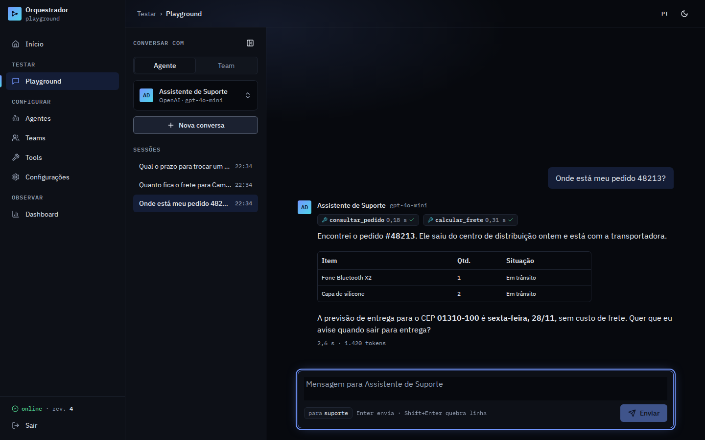
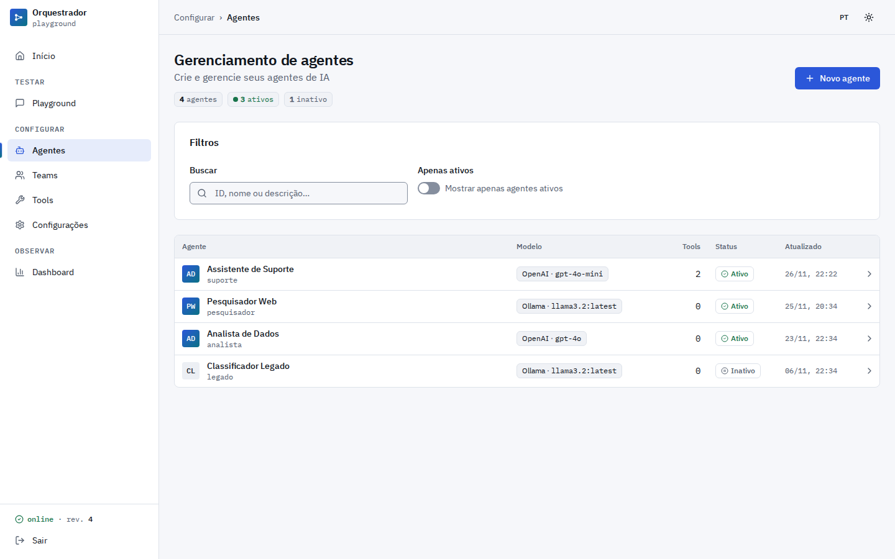
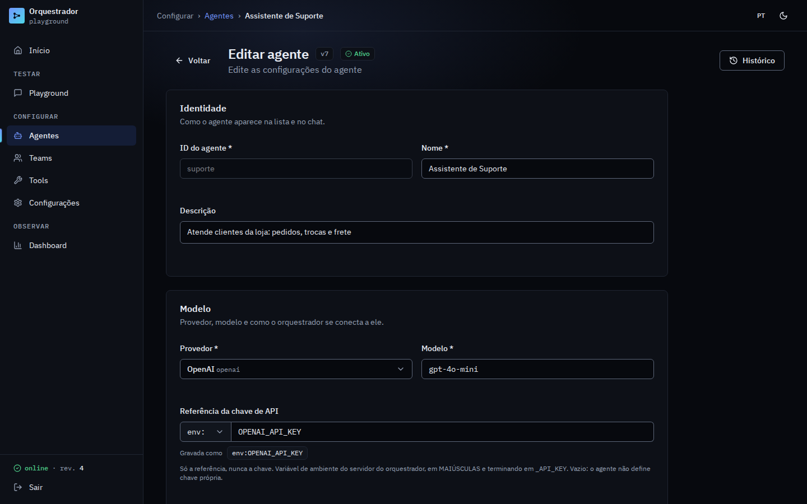
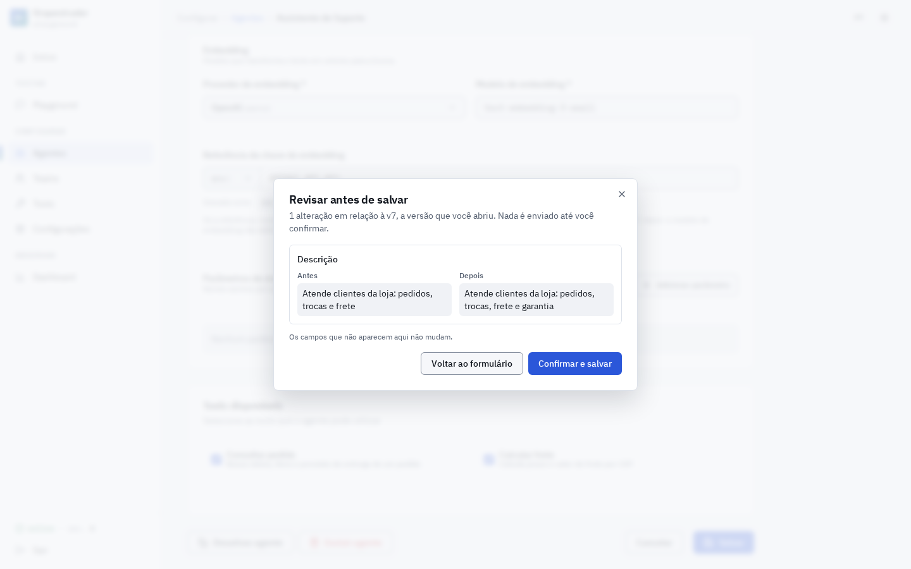
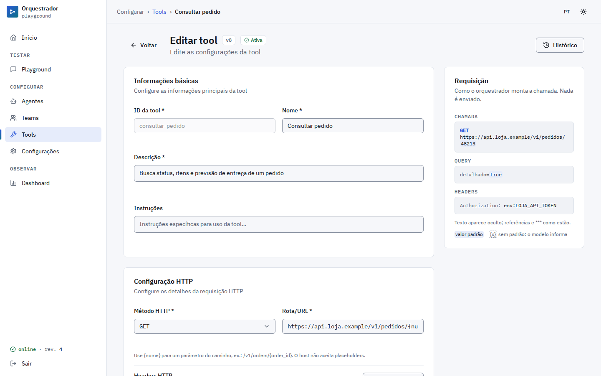
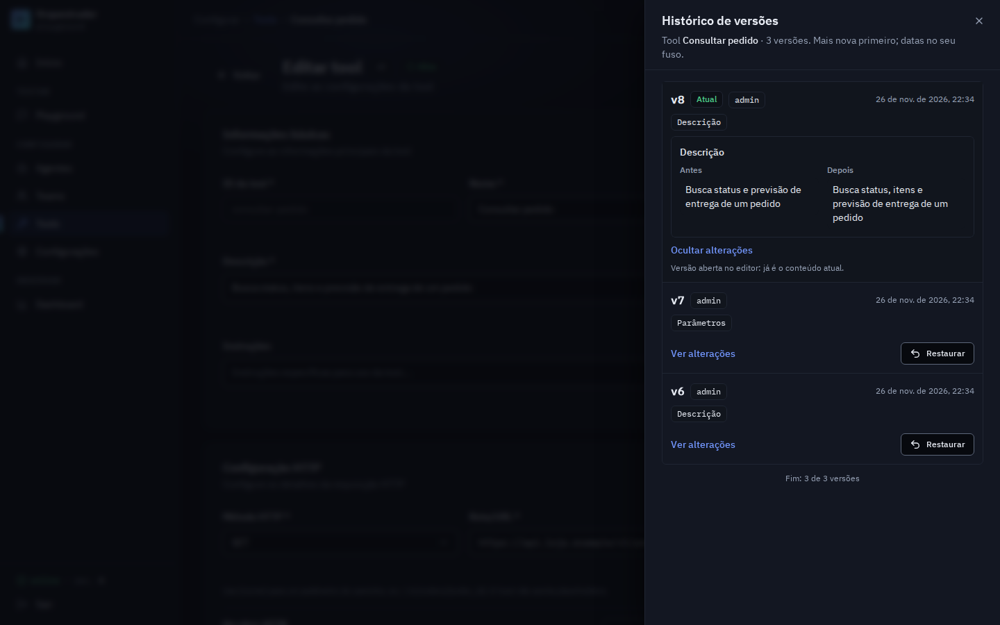
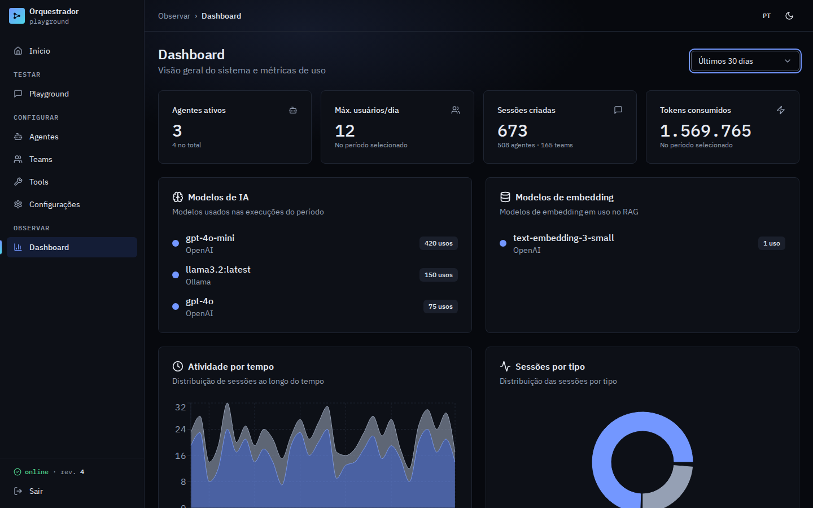
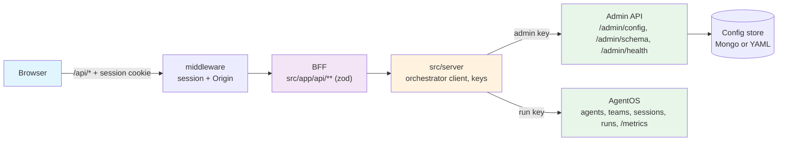

# 🖥️ Orchestrator Playground / Playground do Orquestrador

<div align="center">


[](https://github.com/Mosfet04/playgroundOrquestrador/actions/workflows/ci.yml)


*Management UI for the [AI Agents Orchestrator](https://github.com/Mosfet04/orquestradorIAPythonArgo): configure agents, teams and HTTP tools, try them in a streaming chat and follow usage, with changes applied live through the orchestrator's Admin API.*

**📖 Full Documentation / Documentação Completa**

🇧🇷 **[Documentação em Português](README.pt-br.md)** | 🇺🇸 **[English Documentation](README.en.md)**

</div>



---

## 🚀 Quick Start

```bash
git clone https://github.com/Mosfet04/playgroundOrquestrador.git
cd playgroundOrquestrador
pnpm install                                   # Node 22.18+ or 24+, pnpm only

# sign-in password hash (read from stdin, stays out of shell history)
read -rs PW && printf '%s' "$PW" | pnpm -s auth:hash; unset PW
```

Create `.env.local` (all server-only, validated at startup):

```env
ORCHESTRATOR_URL=http://localhost:7777
ORCHESTRATOR_API_KEY_RUN=<orchestrator API_KEY_RUN>
ORCHESTRATOR_API_KEY_ADMIN=<orchestrator API_KEY_ADMIN>
SESSION_SECRET=<random, 32+ characters>
AUTH_USERNAME=admin
AUTH_PASSWORD_HASH=<output of pnpm auth:hash>
```

```bash
pnpm dev                                       # http://localhost:3000
```

Requires the [orchestrator](https://github.com/Mosfet04/orquestradorIAPythonArgo) running with `API_KEY_RUN` and `API_KEY_ADMIN`. Production: `pnpm build && pnpm start`, served over HTTPS behind a proxy that sets `X-Forwarded-For`. Details: [README.en.md](README.en.md#-quick-start) · [README.pt-br.md](README.pt-br.md#-início-rápido).

## 🖼️ Screens

| Agents | Agent editor | Review before saving |
|---|---|---|
|  |  |  |
| **Tool editor** | **Version history** | **Dashboard** |
|  |  |  |

## 🏗️ Architecture



The browser never sees an orchestrator key or URL, and the playground has no database: every write goes through the Admin API, which validates, stores and hot-swaps the runtime.

## ✨ Key Features

- 💬 **Chat playground**: agents and teams with streaming, tool-call chips, reasoning steps, time and tokens, per-user sessions, readable model errors with Resend
- 🤖 **Full editors**: agents, teams and HTTP tools covering the whole orchestrator document, driven by `/admin/schema`
- 🛡️ **Safe saves**: Before × After review, 412 conflict dialog, apply status with runtime revision, unsaved-draft guard
- 🕓 **History and restore**: every Admin API write is a version you can inspect and restore
- 🔑 **Secrets by reference**: only `env:`/`file:` references; text headers come back masked as `***`
- 📊 **Dashboard** and 🩺 **Settings**: usage metrics, orchestrator health, providers, Reload runtime and a live connection indicator
- 🔐 **Sign-in**: single user, signed 12 h session, per-IP rate limit, Origin check on mutations
- 🎨 **Design system**: light/dark tokens, IBM Plex, responsive layout, pt-BR and EN
- 🧪 **Tests**: Vitest + Testing Library + MSW, Playwright against a fake orchestrator, OpenAPI contract check in CI

---

## 📚 Documentation

### 🇧🇷 Português

**[README completo em português](README.pt-br.md)**: telas, configuração, como usar, funcionalidades em detalhe, arquitetura, segurança, desenvolvimento e solução de problemas.

### 🇺🇸 English

**[Complete English README](README.en.md)**: screens, configuration, usage, features in depth, architecture, security, development and troubleshooting.

Also: [roadmap](docs/roadmap/README.md) · [technical decisions](docs/decisions/) · [design system](docs/design/design-system.md) · [changelog](CHANGELOG.md)

## 🤝 Contributing

1. Work follows the [roadmap](docs/roadmap/README.md), one item at a time ([CONTRIBUTING.md](CONTRIBUTING.md))
2. Gates: `pnpm lint && pnpm typecheck && pnpm test && pnpm build && pnpm test:e2e`
3. Follow [CLAUDE.md](CLAUDE.md): keys only in `src/server`, zod at every boundary, colors only via design tokens, UI text only via `messages/*.json`

## 📄 License

MIT, see [LICENSE](LICENSE). Started as a fork of [agno-agi Agent UI](https://github.com/agno-agi/agent-ui).

---

<div align="center">

Made with ❤️ by [Mateus Meireles Ribeiro](https://github.com/Mosfet04)

</div>
