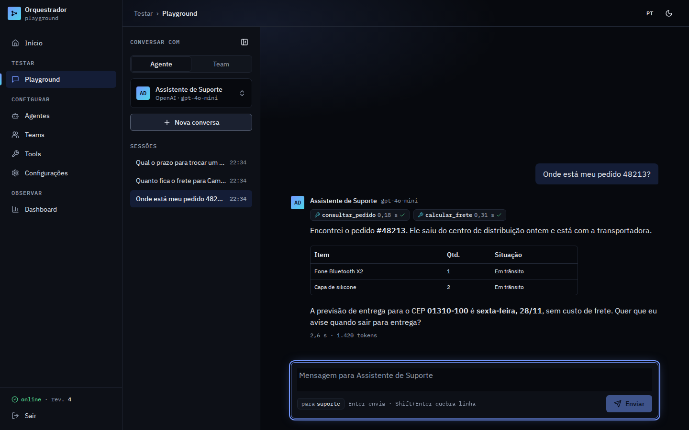
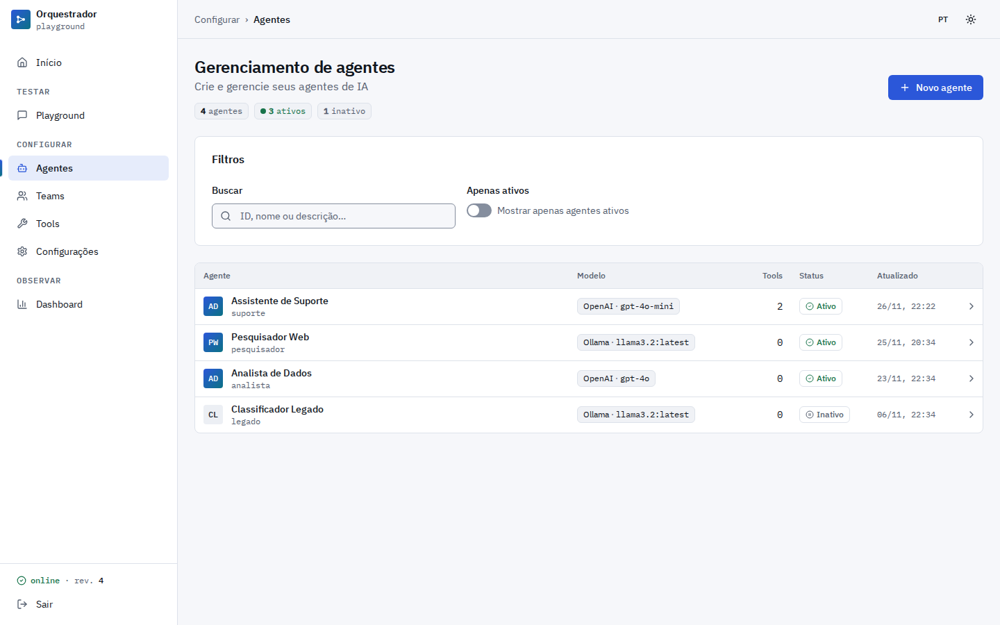
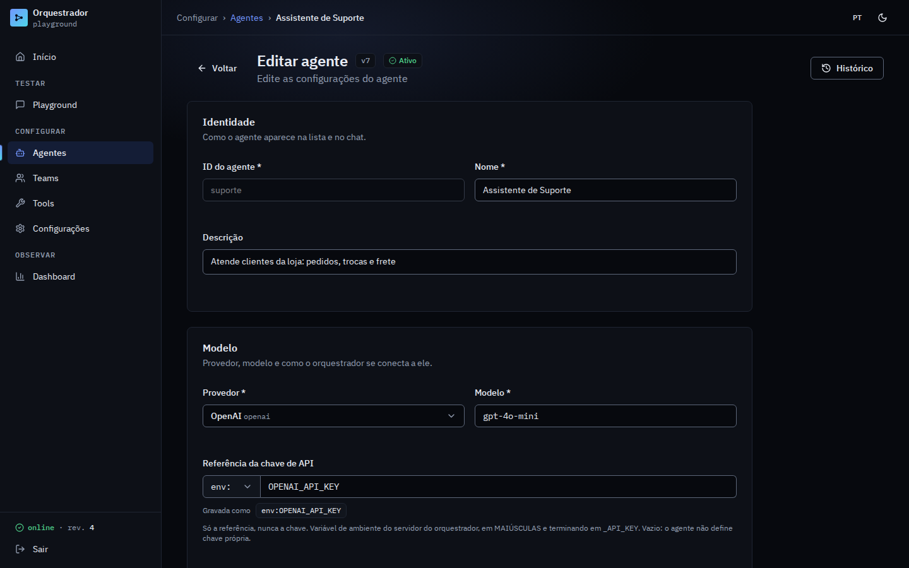
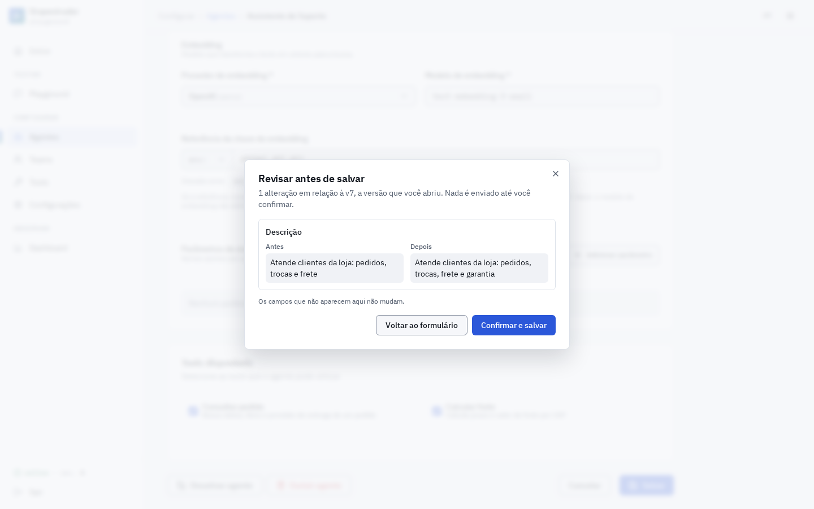
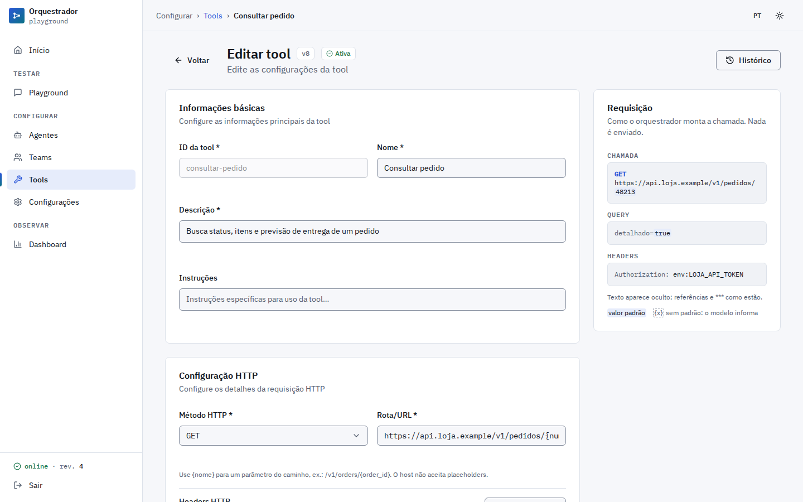
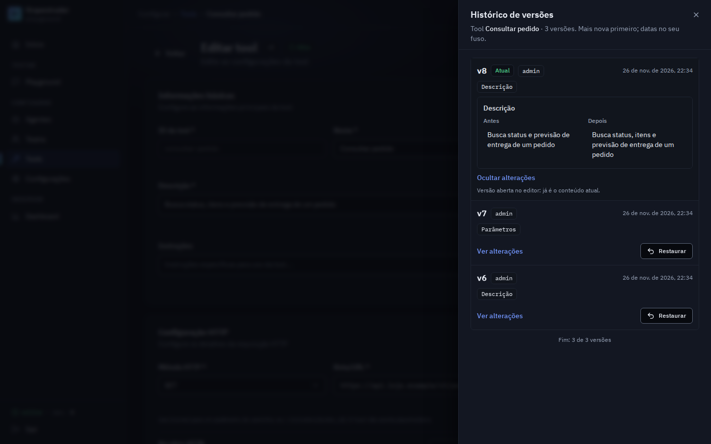
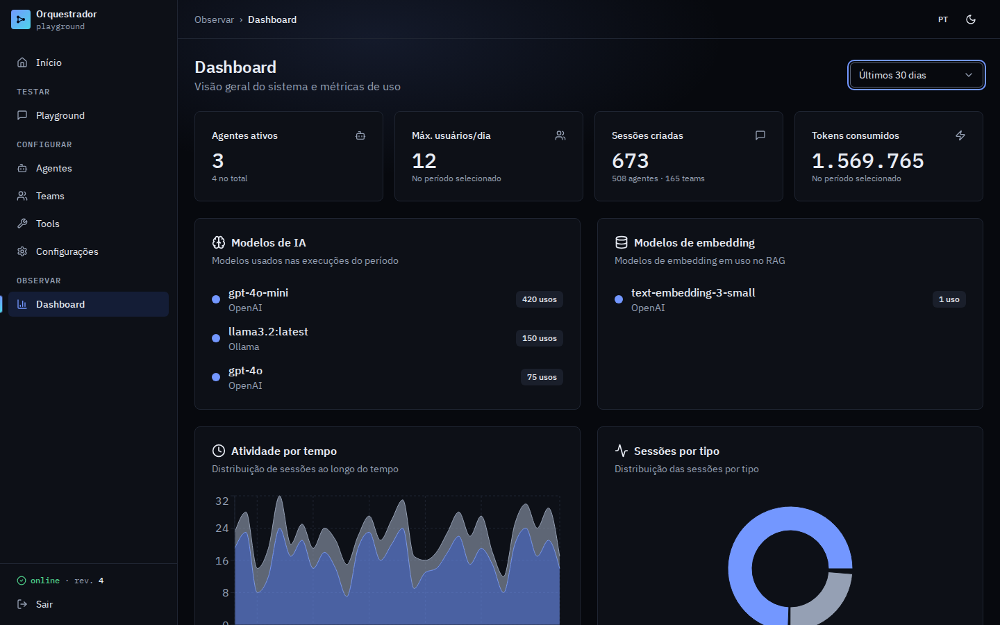
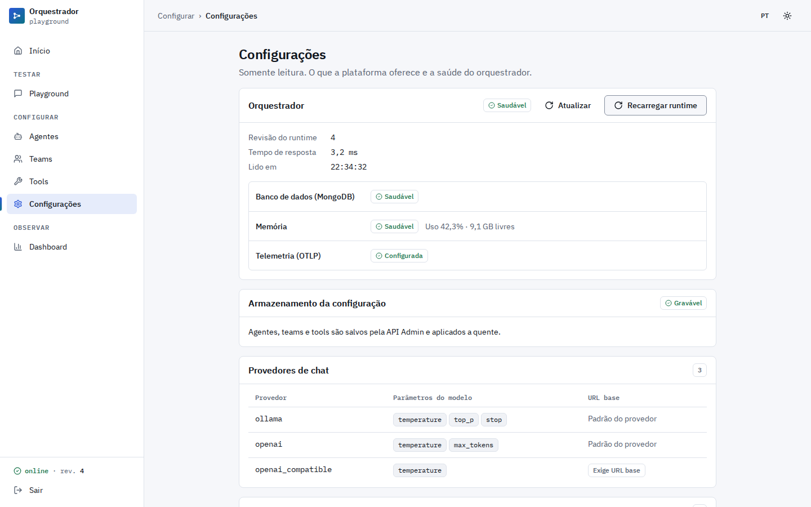
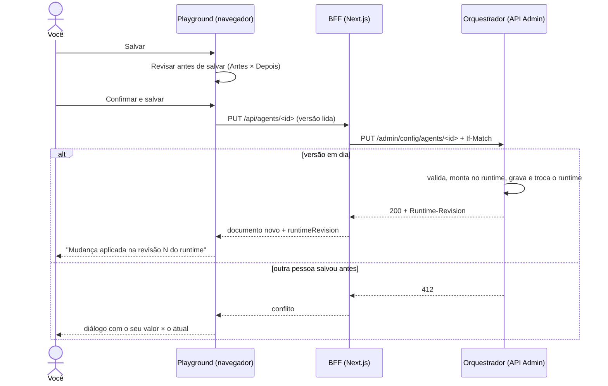
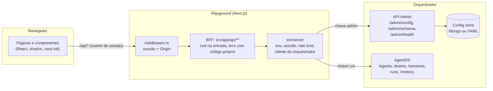

# 🖥️ Playground do Orquestrador

> Guia completo em português. **[English guide](README.en.md)** · **[Página inicial](README.md)**

Interface web de gestão do [Orquestrador de Agentes IA](https://github.com/Mosfet04/orquestradorIAPythonArgo): você cria e edita agentes, teams e tools HTTP, testa tudo num chat com streaming e acompanha o uso num dashboard. O que você salva vai para a config do orquestrador e já vale no chat, sem reiniciar nada.



---

## 📋 Índice

- [Visão geral](#-visão-geral)
- [Telas](#️-telas)
- [Início rápido](#-início-rápido)
- [Configuração](#️-configuração)
- [Como usar](#-como-usar)
- [Funcionalidades em detalhe](#-funcionalidades-em-detalhe)
- [Arquitetura](#️-arquitetura)
- [Interface e acessibilidade](#-interface-e-acessibilidade)
- [Segurança](#-segurança)
- [Desenvolvimento](#️-desenvolvimento)
- [Solução de problemas](#-solução-de-problemas)
- [Licença e créditos](#-licença-e-créditos)

---

## 🎯 Visão geral

O playground é a interface de gestão do orquestrador. Ele não tem banco próprio e não acessa o Mongo: lê e grava tudo pela **API Admin** do orquestrador (`/admin/config/*`), que valida, persiste e aplica a config a quente. O navegador fala só com o próprio playground. Um **BFF** (as rotas `src/app/api/**` do Next.js) guarda a URL e as chaves do orquestrador no servidor.

### Principais características

- 💬 **Playground de chat**: conversa com agentes e teams com streaming, chamadas de tool com tempo e status, painel de raciocínio, tempo e tokens de cada resposta, histórico de sessões por usuário e erro do modelo explicado em linguagem simples, com **Reenviar**.
- 🤖 **Editores completos**: agentes, teams e tools HTTP cobrem o documento inteiro do orquestrador. Os formulários se montam a partir do `GET /admin/schema`: provedores, modelos, parâmetros, modos de team, métodos HTTP e tipos de parâmetro vêm de lá.
- 🛡️ **Salvar sem surpresa**: diff "Antes × Depois" antes de gravar, diálogo de conflito quando outra pessoa salvou no meio, status de aplicação com a revisão do runtime, aviso de rascunho ao sair com edição pendente.
- 🕓 **Histórico e restaurar**: cada escrita pela API Admin vira uma versão, com o que mudou e um botão para restaurar.
- 🔑 **Segredos só por referência**: chave de API e headers de credencial aceitam apenas `env:<VARIAVEL>` ou `file:/caminho`. O valor nunca passa pelo playground.
- 📊 **Dashboard**: agentes ativos, pico diário de usuários, sessões, tokens, modelos e atividade por dia, com filtro de período.
- 🩺 **Configurações**: saúde do orquestrador, revisão do runtime, config store, provedores disponíveis e "Recarregar runtime". O rodapé da navegação mostra se o orquestrador está online, degradado ou fora do ar.
- 🔐 **Login**: um usuário configurado no servidor, sessão assinada de 12 h e limite de tentativas por IP.
- 🎨 **Design system próprio**: tema claro e escuro por tokens, IBM Plex, layout responsivo (navegação vira menu lateral no celular), pt-BR e EN.
- 🧪 **Testado de ponta a ponta**: Vitest + Testing Library + MSW, Playwright contra um orquestrador falso e contrato OpenAPI conferido na CI.

---

## 🖼️ Telas

| | |
|---|---|
| **Lista de agentes**: busca, filtro de ativos, contadores, provedor e modelo, data da última gravação. | **Editor de agente**: identidade, modelo, chave por referência, parâmetros, instruções, execução, RAG e tools. |
|  |  |
| **Revisar antes de salvar**: só os campos que mudaram, sem expor segredo. Nada é enviado até confirmar. | **Editor de tool**: a rota com `{param}` ligada aos parâmetros e o card "Requisição" mostrando a chamada que o orquestrador vai montar. |
|  |  |
| **Histórico de versões**: quem gravou (papel da chave), quando e o que mudou, com Restaurar. | **Dashboard**: indicadores, modelos usados e atividade no período escolhido. |
|  |  |
| **Configurações**: saúde, revisão do runtime, config store e provedores. | |
|  | |

> As capturas usam dados de demonstração servidos pelo orquestrador falso dos testes (`e2e/fake-orchestrator/`).

---

## 🚀 Início rápido

### Pré-requisitos

- **Node.js** 22.18+ ou 24+
- **pnpm** 10.33.0 (o projeto usa só pnpm; a versão vem do `packageManager` do `package.json`)
- **Orquestrador** rodando, com `API_KEY_RUN` e `API_KEY_ADMIN` definidas ([README do orquestrador](https://github.com/Mosfet04/orquestradorIAPythonArgo))

### Instalação

```bash
git clone https://github.com/Mosfet04/playgroundOrquestrador.git
cd playgroundOrquestrador
pnpm install
```

Gere o hash da senha do login. A senha entra pelo stdin e não fica no histórico do shell:

```bash
read -rs PW && printf '%s' "$PW" | pnpm -s auth:hash; unset PW
# saída: scrypt:<sal>:<hash>  → valor de AUTH_PASSWORD_HASH
```

Crie o `.env.local`:

```env
ORCHESTRATOR_URL=http://localhost:7777
ORCHESTRATOR_API_KEY_RUN=<API_KEY_RUN do orquestrador>
ORCHESTRATOR_API_KEY_ADMIN=<API_KEY_ADMIN do orquestrador>
SESSION_SECRET=<segredo aleatório de 32+ caracteres, ex.: openssl rand -base64 48>
AUTH_USERNAME=admin
AUTH_PASSWORD_HASH=<saída do pnpm auth:hash>
```

Suba o playground:

```bash
pnpm dev          # http://localhost:3000
```

Entre com o usuário e a senha do `.env.local`. A tela **Início** traz um guia de três passos (criar agente, criar tool, testar no playground).

**Dados de exemplo (opcional):** use o seed do orquestrador (`mongo-init/` para o Mongo, `config.example.yaml` para o store YAML) ou crie tudo pelas telas.

**Produção:** `pnpm build` e `pnpm start`. As variáveis só precisam existir no `start`. Sirva por HTTPS: fora do `pnpm dev` o cookie de sessão é `Secure`. O repositório não tem Dockerfile.

---

## ⚙️ Configuração

### Variáveis de ambiente

| Variável | O que é |
|---|---|
| `ORCHESTRATOR_URL` | URL do orquestrador, `http(s)://` (ex.: `http://localhost:7777`). Para trocar de orquestrador, mude a variável e reinicie. |
| `ORCHESTRATOR_API_KEY_RUN` | A `API_KEY_RUN` do orquestrador: chat e sessões. |
| `ORCHESTRATOR_API_KEY_ADMIN` | A `API_KEY_ADMIN` do orquestrador: config, schema, métricas, saúde e exclusão de sessão. |
| `SESSION_SECRET` | Segredo que assina o cookie de sessão, com 32 caracteres ou mais. |
| `AUTH_USERNAME` | Usuário do login. |
| `AUTH_PASSWORD_HASH` | Hash scrypt da senha, gerado por `pnpm auth:hash`. Nunca a senha em claro. |

As variáveis são validadas por zod em `src/server/env.ts` e existem só no servidor. Se faltar alguma, o servidor recusa as requisições e o log cita só o nome da variável, nunca o valor. No `pnpm dev` isso acontece ao subir; no `pnpm start`, na primeira requisição, quando o Next roda o `src/instrumentation.ts`.

### Login e sessão

- Um usuário só, definido por `AUTH_USERNAME` e `AUTH_PASSWORD_HASH`. Todas as páginas e todo o `/api/*` exigem sessão.
- A sessão é um cookie assinado (jose) que dura **12 h**, sem renovação. Não há revogação no servidor: trocar o `SESSION_SECRET` derruba todas as sessões abertas.
- O login aceita **5 tentativas por IP a cada 15 min**. A 6ª recebe 429, e entrar com a senha certa zera a contagem. O contador fica na memória do processo, então vale para uma réplica e zera ao reiniciar.
- O IP é o último valor do `X-Forwarded-For`. **Sirva o playground atrás de um proxy que grave esse header** (nginx, Caddy, o balanceador da nuvem). Sem ele, o cliente escolhe o valor e o limite por IP não se sustenta.
- Mutações (POST, PUT, DELETE) exigem `Origin` do próprio playground (`src/middleware.ts`).
- O `user_id` das sessões de chat é o usuário do login: cada usuário vê só as próprias conversas.

---

## 🧭 Como usar

1. **Cadastre uma tool** em **Tools → Nova tool**. Exemplo: ID `consultar-pedido`, método `GET`, rota `https://api.loja.example/v1/pedidos/{numero}`, header `Authorization` com o segredo `env:LOJA_API_TOKEN` e o parâmetro `numero` (string, obrigatório). O card **Requisição** mostra a chamada antes de salvar.
2. **Crie um agente** em **Agentes → Novo agente**: provedor e modelo, referência da chave (`env:OPENAI_API_KEY`), instruções, as tools que ele pode usar e, se quiser, o RAG.
3. **Teste no Playground**: escolha o agente e converse. Depois de salvar um agente ou team, o botão **Testar agora** abre o playground já com ele selecionado e uma conversa vazia.
4. **Monte um team** em **Teams → Novo team**: marque os agentes membros, escolha o modo de coordenação (cada modo vem com a descrição) e o modelo do líder.
5. **Acompanhe** o uso no **Dashboard** e a saúde do orquestrador em **Configurações**.

Toda mudança vale no chat **logo depois de salvar**: a API Admin monta a config, grava e troca o runtime em seguida.

---

## ⚡ Funcionalidades em detalhe

### 💬 Playground de chat

- Abas **Agente** e **Team**, com o seletor da entidade (provedor e modelo à vista) e a lista de sessões do usuário logado, relida do servidor ao fim de cada resposta.
- Streaming sem buffer: o BFF repassa o stream do run do orquestrador direto ao navegador.
- **Chamadas de tool** como chips com nome, tempo e status (executando, concluída, erro). Em teams, aparece a delegação para o membro.
- **Painel de raciocínio** com os passos do agno 3 (título, confiança e detalhe recolhível), para agentes com raciocínio ligado.
- Tempo e tokens de cada resposta; mídia (imagem, áudio, vídeo).
- Markdown do agente e do usuário renderizado sem HTML cru: links só `http(s)`/`mailto` com `rel` seguro, imagem vira link sem carregar.
- **Erro do modelo** vira uma frase por tipo (provedor sobrecarregado ou no limite, parâmetro recusado, outro). O texto do provedor, saneado pelo BFF, fica em **Detalhes técnicos**. **Reenviar** repete a mesma mensagem na mesma sessão. Ao reabrir a sessão, a pergunta que ficou sem resposta aparece marcada, com Reenviar.
- A URL guarda a entidade e a sessão (`?agent=`, `?team=`, `?session=`): dá para favoritar, abrir em nova aba e usar Voltar/Avançar.
- Conversa de outro usuário é recusada com a mensagem "Esta conversa é de outro usuário. Comece uma nova."

### 📋 Listas de agentes, teams e tools

- Busca por ID, nome ou descrição; filtro **Apenas ativos**; contadores (total, ativos, inativos).
- Colunas de provedor e modelo (rótulo legível, ex. `OpenAI · gpt-4o-mini`), quantidade de tools, status e **Atualizado**: a hora da última gravação (`updated_at` da API Admin, no fuso do navegador). Documento sem essa data, como os do store YAML ou do seed, mostra "—".
- Lista, busca e filtros correm no BFF sobre a lista inteira.

### 🤖 Editor de agente

- **Identidade**: ID (só `a-z`, `0-9`, `-` e `_`, fixo depois de criado), nome e descrição.
- **Modelo**: provedor, modelo, URL base (aparece e é obrigatória quando o provedor exige), referência da chave de API e parâmetros do modelo (`temperature`, `max_tokens`…, conforme o provedor). O tipo do valor é inferido, e `0,7` vira `0.7`.
- **Instruções** (prompt) e **Execução**: Markdown, data e hora no contexto, histórico (com o número de execuções na faixa do schema), raciocínio, expor raciocínio, memória do usuário e resumo da sessão, cada um com o padrão do orquestrador.
- **RAG**: documento, estratégia de busca (semântica ou hierárquica), embedder (provedor, modelo, parâmetros, URL base, referência da chave). Desligar guarda os valores com `active: false`.
- **Tools disponíveis**: as tools cadastradas como cartões marcáveis; sem nenhuma, o atalho "Criar tool".
- Salvar envia o documento do formulário. O que a tela não conhece (uma chave nova do orquestrador, por exemplo) é preservado.

### 👥 Editor de team

- **Membros**: os agentes como linhas marcáveis, com busca. Pelo menos um é obrigatório, e a ordem gravada se mantém. Um ID gravado que já não existe aparece marcado com aviso.
- **Modo de coordenação**: um cartão por modo que o schema oferece (ex.: `route`, `coordinate`, `broadcast`), com a descrição. Um valor gravado fora da lista é preservado até você trocar.
- **Modelo do líder**, instruções e execução (com memória do usuário).
- Excluir um agente que é membro de team é recusado pelo orquestrador; o diálogo lista os teams, com link para cada um.

### 🔧 Editor de tool

- Método, rota e headers. A rota aceita `{param}` no caminho e na query (no host, não). Um placeholder sem parâmetro de mesmo nome bloqueia o envio, e o editor oferece criar o parâmetro.
- Parâmetros com nome, tipo (`string`, `integer`, `float`, `boolean`, `object`, `array`), descrição, obrigatório e valor padrão. O valor padrão só serve de exemplo: o orquestrador não o envia na chamada.
- Card **Requisição**: mostra, sem chamar a rota, como o orquestrador monta a chamada (placeholders pelo valor padrão, demais parâmetros na query para GET/DELETE ou no corpo JSON para POST/PUT/PATCH).
- **Headers** em modo Texto ou Segredo. Valor em texto volta mascarado (`***`) e nunca chega ao navegador; salvar sem mexer mantém o valor gravado. Header de credencial (`Authorization`, `Cookie`, `*-Key`, `*-Token`) só aceita referência; digitar um nome desses numa linha vazia troca para Segredo automaticamente.
- Referência de segredo em header só vale para hosts na `TOOL_ROUTE_ALLOWLIST` do orquestrador. Fora dela, o 422 aparece no grupo de headers com o motivo.

### 🔑 Segredos

O mesmo seletor serve para a chave do modelo do agente, do líder do team, do embedder do RAG e dos headers de tool: formato (`env:` ou `file:`) mais o alvo, com a regra do orquestrador (`env:<PROVEDOR>_API_KEY` ou um caminho em `SECRETS_DIR`). Um valor sem esse prefixo é recusado no navegador e nunca sai dele. Um valor já gravado fora da regra aparece com um aviso, para ser corrigido.

### 🛡️ Salvar com segurança



- **Revisar antes de salvar**: numa edição, Salvar abre a lista de campos alterados (Antes × Depois) em relação à versão aberta. Nada é enviado até "Confirmar e salvar", e o que foi listado é exatamente o que vai no PUT. Referência de segredo aparece como está; `***` e header em texto nunca mostram o valor. Sem mudança, o botão Salvar fica apagado com "Nenhuma alteração para salvar." Criar não passa por esse diálogo.
- **Conflito (412)**: se a config mudou depois que você abriu o editor, o diálogo relê a versão atual e compara campo a campo. Saídas: voltar ao formulário, recarregar a atual (descarta as suas edições) ou salvar as suas por cima.
- **Status de aplicação**: depois de salvar, o editor mostra "Mudança aplicada na revisão N do runtime", "Não aplicada" (a config não monta: nada gravado, a versão anterior segue no ar) ou "Não confirmada" (o orquestrador falhou depois de receber; "Recarregar" mostra o que ficou gravado).
- **Testar agora**: no status "aplicada" de agentes e teams, leva ao playground com a entidade e uma conversa vazia.
- **Campo recusado (422)**: o campo que o orquestrador recusa aparece no formulário com "Valor recusado pelo orquestrador", sem ecoar o valor.
- **Rascunho**: com edição não salva, sair por um link, Voltar/Cancelar, "Sair", Voltar/Avançar do navegador ou fechar a aba pede confirmação.
- **Desativar, reativar e excluir**: o cabeçalho mostra o selo Ativo/Inativo; o rodapé tem Desativar ou Reativar (não gravam as edições do formulário) e Excluir, que apaga de vez.

### 🕓 Histórico e restaurar

O botão **Histórico** (agentes, teams e tools) abre um painel com as escritas feitas pela API Admin, da mais nova para a mais antiga, 20 por vez: versão, papel da chave que gravou (`admin`, `local-dev`; nunca uma pessoa), data no seu fuso e os campos alterados, com Antes × Depois. **Restaurar** mostra o que muda da versão atual para a escolhida, avisa que descarta edições não salvas e grava uma versão nova ("v6 restaurada como v9"). No store YAML o histórico é sempre vazio.

### 📊 Dashboard

Agentes ativos (e o total), pico diário de usuários, sessões de agente e de team, tokens consumidos, modelos de IA e de embedding em uso, atividade por dia e sessões por tipo. Filtro de período: Hoje, 7, 30 e 90 dias (dias UTC). Os números vêm do `GET /metrics` do orquestrador. O BFF pede o recálculo (`POST /metrics/refresh`) no máximo uma vez por minuto; se falhar, a leitura segue com o que houver. O consumo de tokens por agente espera as métricas por agente do orquestrador.

### 🩺 Configurações e status de conexão

- Saúde do orquestrador (`/admin/health`): estado geral, revisão do runtime, tempo de resposta e os checks (banco, memória, telemetria).
- Config store gravável ou somente leitura. Com o store somente leitura, os formulários avisam e desabilitam campos, Salvar e Excluir.
- Provedores de chat e de embedder, com os parâmetros de cada um e se exigem URL base.
- **Recarregar runtime** (com confirmação): relê o store e devolve a revisão nova. Use depois de editar o YAML do orquestrador à mão.
- O rodapé da navegação mostra "online · rev. N", "degradado · rev. N" ou "fora do ar", com link para a página. Fora do ar ou degradado, ele tenta de novo com espera crescente (5, 15, 30, 60 s) e quando a aba volta ao foco.

---

## 🏗️ Arquitetura



**Regras que a arquitetura garante:**

- **O navegador nunca vê chave nem URL do orquestrador.** Só `src/server` as conhece, e esse código não pode ser importado por componente cliente (`import 'server-only'` mais a regra de lint `no-restricted-imports`).
- **A config é do orquestrador.** O playground não acessa banco: escreve pela API Admin, que valida, persiste e aplica a quente.
- **zod em toda fronteira**: corpo das requisições, respostas do orquestrador e env.
- **Erro com código próprio**: o cliente nunca recebe `String(err)`, stack ou o texto cru do orquestrador.
- **Concorrência otimista**: a `version` lida volta no `If-Match` ao salvar, excluir, desativar e restaurar.

### Estrutura de pastas

```
src/
├── app/
│   ├── (app)/               # rotas com a casca (navegação + cabeçalho):
│   │                        # /, /playground, /agents, /teams, /tools (lista, /new, /<id>),
│   │                        # /dashboard, /settings; error.tsx, not-found.tsx e 404 da casca
│   ├── api/                 # BFF: agents, teams, tools (+ history/restore), config (schema,
│   │                        # reload), dashboard, orchestrator (health, runtime), playground, auth
│   └── login/               # tela de login (fora da casca)
├── components/
│   ├── layout/              # casca, navegação, cabeçalho, tema, idioma, status de conexão
│   ├── management/          # agents, teams, tools, dashboard, settings, Início
│   │   └── common/          # peças dos editores: diff, conflito, histórico, segredo, rascunho
│   ├── playground/          # chat e painel de sessões
│   └── ui/                  # primitivos shadcn (sem regra de negócio)
├── hooks/                   # stream do chat, sessões, entidade selecionada
├── i18n/                    # next-intl: idioma pelo cookie
├── lib/                     # código puro: diff, segredo, rota e preview de tool, provedor...
├── server/                  # 'server-only': env, sessão, senha, rate limit
│   └── orchestrator/        # cliente do orquestrador, um módulo por domínio + openapi.d.ts
├── middleware.ts            # sessão obrigatória em páginas e /api/*, Origin nas mutações
└── store.ts                 # zustand: só o estado de sessão do chat
messages/                    # textos de UI (pt-BR.json, en.json)
docs/                        # roadmap, decisões, design, contrato OpenAPI, QA
e2e/                         # Playwright + orquestrador falso
tests/                       # Vitest + Testing Library + MSW
```

### Formato da config

O formato é o da API Admin do orquestrador: documento snake_case com `version`. Campos legados (`nome`, `descricao`) seguem no contrato.

<details>
<summary><strong>Agent</strong> (<code>/admin/config/agents/&lt;id&gt;</code>)</summary>

```json
{
  "id": "suporte",
  "nome": "Assistente de Suporte",
  "descricao": "Atende clientes da loja: pedidos, trocas e frete",
  "factory_ia_model": "openai",
  "model": "gpt-4o-mini",
  "api_key_ref": "env:OPENAI_API_KEY",
  "model_params": { "temperature": 0.3 },
  "prompt": "Você é o assistente de suporte da loja...",
  "tools_ids": ["consultar-pedido"],
  "rag_config": {
    "active": true,
    "doc_name": "politica-de-trocas",
    "factory_ia_model": "openai",
    "model": "text-embedding-3-small",
    "search_strategy": "semantic",
    "api_key_ref": "env:OPENAI_API_KEY"
  },
  "markdown": true,
  "add_history_to_context": true,
  "num_history_runs": 5,
  "user_memory_active": true,
  "active": true,
  "version": 7
}
```
</details>

<details>
<summary><strong>Team</strong> (<code>/admin/config/teams/&lt;id&gt;</code>)</summary>

```json
{
  "id": "atendimento",
  "nome": "Time de Atendimento",
  "descricao": "Roteia o cliente para o agente certo",
  "prompt": "Encaminhe pedidos ao suporte e dúvidas de produto ao pesquisador.",
  "member_ids": ["suporte", "pesquisador"],
  "mode": "route",
  "factory_ia_model": "openai",
  "model": "gpt-4o-mini",
  "user_memory_active": true,
  "summary_active": false,
  "active": true,
  "version": 2
}
```
</details>

<details>
<summary><strong>Tool</strong> (<code>/admin/config/tools/&lt;id&gt;</code>)</summary>

```json
{
  "id": "consultar-pedido",
  "name": "Consultar pedido",
  "description": "Busca status, itens e previsão de entrega de um pedido",
  "route": "https://api.loja.example/v1/pedidos/{numero}",
  "http_method": "GET",
  "headers": { "Authorization": "env:LOJA_API_TOKEN", "X-Conta": "***" },
  "parameters": [
    { "name": "numero", "type": "string", "description": "Número do pedido", "required": true }
  ],
  "active": true,
  "version": 5
}
```
</details>

A `description` da tool e de cada parâmetro é obrigatória. O `updated_at` que a API devolve é metadado, como a `version`: o PUT não o reenvia.

---

## 🎨 Interface e acessibilidade

- **Design system**: cores só por tokens (CSS vars do shadcn em `src/app/globals.css`, `:root` para o claro e `.dark` para o escuro), mapeados no `tailwind.config.ts`. Nada de hex nem paleta crua nos componentes. Direção visual e tokens em [`docs/design/design-system.md`](docs/design/design-system.md).
- **Tipografia**: IBM Plex Sans e Mono, servidas pelo próprio app (`next/font/local`).
- **Tema**: Claro, Escuro ou Sistema (padrão), no botão do cabeçalho; fica no `localStorage`.
- **Idioma**: pt-BR (padrão) e EN com `next-intl`, no botão `PT`/`EN`. Fica no cookie `locale`, não entra na URL e troca sem recarregar nem perder a conversa. Os textos ficam em `messages/*.json`; o lint recusa texto literal em JSX e um teste confere que os dois catálogos têm as mesmas chaves. O conteúdo gerado pelos agentes não é traduzido.
- **Responsivo**: navegação fixa a partir de 1024 px; abaixo disso, menu lateral (Sheet). Controles maiores e área de toque de 44 px no celular.
- **Estados**: carregando (esqueleto na altura final), vazio e erro com "Tentar de novo" em todas as telas; endereço inexistente mostra o 404 dentro do app.
- **Acessibilidade**: foco visível em todo elemento interativo, erros de campo com `aria-invalid`/`aria-describedby` e anúncio por `aria-live`, contraste conferido nos dois temas e animações desligadas com `prefers-reduced-motion`.

---

## 🔒 Segurança

| Risco | Como o playground trata |
|---|---|
| Vazamento de chave ou URL interna | Só o servidor (`src/server`) conhece; a CI confere que nenhum segredo de teste aparece no bundle (`.next/static`). |
| Acesso sem login | `middleware.ts` exige sessão em todas as páginas e em `/api/*`. |
| CSRF | Mutações só com `Origin` do próprio playground; cookie `HttpOnly`, `SameSite=Lax` e `Secure` fora do dev. |
| Força bruta no login | 5 tentativas por IP a cada 15 min (exige proxy que grave `X-Forwarded-For`). |
| XSS pelo conteúdo do agente | Markdown sem HTML cru (`rehype-sanitize` com schema estrito, sem `rehype-raw`), links filtrados, imagens como link. |
| Segredo gravado na config | Só referência (`env:`/`file:`); header em texto volta como `***` e nunca chega ao navegador. |
| Vazamento por mensagem de erro | Respostas com código próprio; texto do provedor saneado e com teto de tamanho. |
| Sessão de outro usuário | O `user_id` vem do login; conversa alheia é recusada. |

---

## 🛠️ Desenvolvimento

**Stack:** Next.js 15 (App Router), React 18, TypeScript, Tailwind + shadcn/ui (Radix), zustand (sessão do chat), nuqs (estado na URL), next-intl, react-hook-form, zod, recharts, jose.

### Comandos

```bash
pnpm dev              # http://localhost:3000
pnpm lint             # ESLint (inclui a regra de texto literal e a fronteira server/client)
pnpm typecheck        # TypeScript
pnpm test             # Vitest + Testing Library + MSW (tests/)
pnpm test:watch
pnpm test:e2e         # Playwright (Chromium) contra o orquestrador falso
                      # 1ª vez: pnpm exec playwright install chromium
pnpm build
pnpm format           # Prettier (checagem)
pnpm contract:check   # tipos do orquestrador em dia com o snapshot do contrato
pnpm contract:update  # baixa o snapshot de um orquestrador local e regenera os tipos
```

### Testes

- **Unidade, componente e BFF** (`tests/`): Vitest + Testing Library + MSW. Requisição fora do mock falha o teste.
- **Fluxos** (`e2e/`): Playwright contra o **orquestrador falso** (`e2e/fake-orchestrator/server.ts`), que imita o AgentOS (agno 3.1.12) e a API Admin, exige as mesmas chaves e não chama LLM nem rede externa.
- Sem `CI`, o `pnpm test:e2e` sobe o app com `next dev`. Com `CI=true`, roda `next build` + `next start`, como na CI. O build sobrescreve `.next`: pare qualquer `next dev` antes.
- O env de teste (usuário, hash, segredo e chaves fictícias) fica em `e2e/test-env.ts`; o projeto `setup` do Playwright entra uma vez pela tela de login e grava a sessão em `e2e/.auth/`.

### Contrato do orquestrador

O BFF fala com o orquestrador só por `src/server/orchestrator/client.ts` (chave run ou admin por chamada, timeout, erro com código próprio, resposta validada com zod). Os tipos (`src/server/orchestrator/openapi.d.ts`, gerado; não edite) vêm do snapshot `docs/contracts/orchestrator-openapi.json`.

Quando o orquestrador mudar a API, suba-o local em development (só lá existe o `/openapi.json`) e rode:

```bash
export ORCHESTRATOR_API_KEY_RUN=<chave run>   # se o orquestrador exigir chave
ORCHESTRATOR_URL=http://127.0.0.1:7777 pnpm contract:update
```

Revise o diff do snapshot e commite os dois arquivos.

### CI

`.github/workflows/ci.yml` roda em push na `main` e em todo PR: `lint`, `typecheck`, `contract:check`, `test`, `build` e `test:e2e` (contra o build de produção), mais a checagem de segredo no bundle.

### Fluxo de trabalho

O plano está em [`docs/roadmap/`](docs/roadmap/README.md), as decisões técnicas em [`docs/decisions/`](docs/decisions/) e as regras do projeto em [`CLAUDE.md`](CLAUDE.md). Cada item passa pelo `/dev-cycle` (design → dev → code review → QA → design QA). Detalhes em [CONTRIBUTING.md](CONTRIBUTING.md). Histórico de versões em [CHANGELOG.md](CHANGELOG.md).

---

## 🩺 Solução de problemas

| Sintoma | O que conferir |
|---|---|
| Listas e dashboard com "Não foi possível carregar…" | `ORCHESTRATOR_URL`, `ORCHESTRATOR_API_KEY_ADMIN` e o orquestrador (`curl http://localhost:7777/health`). "código 502": o orquestrador respondeu com erro ou recusou a chave admin. |
| Playground com "Não foi possível conectar ao orquestrador" | `ORCHESTRATOR_URL` e o orquestrador. "código 502": respondeu com erro ou recusou a chave (confira `ORCHESTRATOR_API_KEY_RUN`). |
| Rodapé mostra "fora do ar" ou "degradado" | Abra **Configurações** para ver qual check falhou (banco, memória, telemetria). |
| Servidor recusa tudo logo ao subir | Falta variável de ambiente: o log cita o nome dela. |
| Login responde 429 | Limite de 5 tentativas em 15 min por IP; espere ou reinicie o processo. |
| Salvar abre "O agente/team/tool mudou" | A config mudou depois que você abriu o editor (412). Compare e escolha recarregar a atual ou salvar as suas por cima. |
| "Não aplicada" depois de salvar | A config não monta no runtime do orquestrador; nada foi gravado e a versão anterior segue no ar. O tipo do erro aparece em detalhes técnicos. |
| 422 nos headers da tool | Referência de segredo em header só vale para hosts na `TOOL_ROUTE_ALLOWLIST` do orquestrador. |
| Formulário desabilitado com aviso de somente leitura | O orquestrador usa um config store somente leitura (YAML). Edite o arquivo e use **Recarregar runtime**. |
| Provedor novo não aparece no select | As opções vêm do `/admin/schema`: um provedor ou plugin novo aparece depois que o orquestrador reinicia. |

---

## 📄 Licença e créditos

[MIT](LICENSE). Começou como um fork do [agno-agi Agent UI](https://github.com/agno-agi/agent-ui) e foi reescrito para o [Orquestrador IA Python](https://github.com/Mosfet04/orquestradorIAPythonArgo). Agradecimentos ao [Agno](https://agno.link), ao [Next.js](https://nextjs.org), ao [shadcn/ui](https://ui.shadcn.com) e ao [Tailwind CSS](https://tailwindcss.com).
